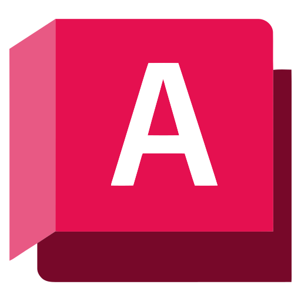

<h1 align="center">Максим Алексеев</h1>

  <b>Строительное образование • 3 года в видеомонтаже • Вайбкод</b> 
  <i>Ищу работу, единомышленников</i>

  
  
  
  
  

 

  
  
  
  
  
  
  
  
  

 

  

###

### Обо мне и моем пути

- **Стройка и ПТО:** Образование «Строительство и эксплуатация зданий и сооружений». Работал в ПТО: ведение исполнительной документации, составление схем, замеры и подсчет объемов, AutoCAD и другое.
- **3 года в видеомонтаже:** Монтировал ролики для креаторов и бизнеса: **Константин Зимен**, **Илья Фаш**, **Bradley Martyn**, **Тоша Шарит**, **Fervent**, **Мусорофф**, **Александр Приказчиков**, онлайн-школы. Сильно выгорел от фриланса, менеджмента и постоянного поиска клиентов.
- **Вайбкодинг:** Сейчас увлекся им. Я не пишу код руками.
- **WarLink:** Сделал для себя утилиту, потому что не было денег на платные решения. В итоге проектом пользуются люди и донатят на серверную инфраструктуру.

###

### Ищу работу, единомышленников

Ищу команду или проект, готов вкладываться и быстро учиться новому:
- **Готов пробовать разное и не боюсь это делать**, давая честный фидбек - мое это или не мое.
- **Готов практически к любой адекватной работе:** стажер, помощник, ручной QA / тестировщик, технический саппорт, автоматизация рутины через ИИ и т.д.
- **Формат:** офлайн в Москве, гибрид или онлайн с живой связью. Без холодных продаж и поиска клиентов.
- **От меня:** высокая работоспособность, инженерная голова, обучаемость.

###

  

